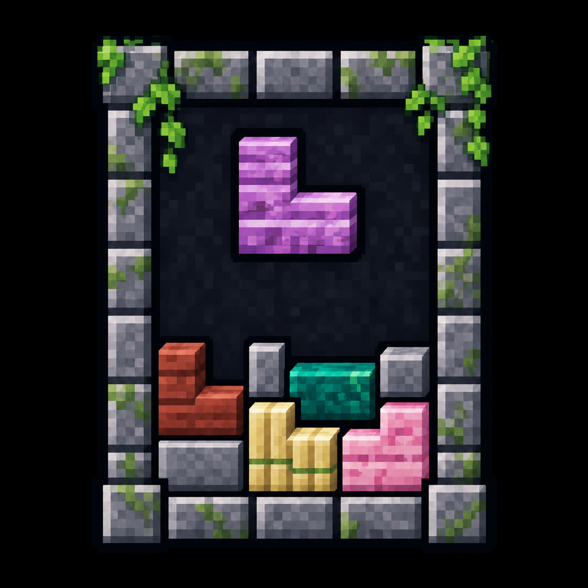

# Sky's Building Pieces — Biomes O' Plenty

Bring Biomes O' Plenty materials into your builds with the same range of pieces
as Sky's Building Pieces. This add-on supplies missing slabs, steps, corners,
stairs and stone walls, using the textures of the original BOP blocks.

## Building with BOP materials

Build with the woods and stone materials in Biomes O' Plenty for Minecraft
1.20.6. Where BOP already has a suitable slab, stair or wall, the add-on uses
it rather than adding another copy.

Craft pieces from matching blocks, slabs and steps, following the core mod's
patterns. Regular slabs also place vertically and drop regular slabs when
broken. Matching pieces can join into supported larger shapes.

Stone walls have lower panels and raised posts, just like the core's
walls. Use BOP's own fences and gates for wooden builds; this add-on doesn't add
wooden walls or generate terrain.

See [crafting](docs/RECIPES.md) for the patterns and quantities.

## Flower Basket

The Flower Basket holds 18 slots of plants, saplings, leaves and other suitable
plant blocks. Right-click with it in either hand to open it. Carry it in your
main inventory and plant items you pick up go into the basket first, with
anything that doesn't fit handled normally.

Craft a basket from six wooden sticks. The [basket guide](docs/FLOWER-BASKET.md)
shows the recipe and explains storage and automatic collection. The basket
holds suitable plant block items, including crop seeds that place plant blocks.
It doesn't accept unrelated items.

## Installation

Use the versions for **Minecraft 1.20.6**, with **Forge 50.2.0** and
**Java 21**. You'll need:

- **Sky's Building Pieces 0.3.8.120061** and this add-on.
- **Biomes O' Plenty 18.4.0.8**, **TerraBlender 3.5.0.5** and **GlitchCore 1.1.0.10**.

Put all five main jars in `mods` on both the client and server.
Downloads are on [CurseForge](https://www.curseforge.com/minecraft/mc-mods/skysbuildingpiecesbop).

For smoother BOP grass and soil, use the separate
[Terrain Smoother BOP add-on](https://github.com/MinecraftModDevelopmentMods/SkysTerrainSmoother-BiomesOPlenty-Addon)
with Sky's Terrain Smoother.

## Existing worlds

Before moving an existing world to this version, read
[existing worlds and modpack notes](docs/WORLD-UPGRADES.md). It covers recovery
for supported old building pieces, retired BOP rocks, decorations, Flower
Baskets and other items. BOP has removed some woods, gems and thatching since
1.12; their saved pieces use similar current woods or coloured terracotta.
Ethereal wood removed after 1.14 uses birch, with white cherry leaves and saplings.
Other retired plants and biomes use the replacements listed in the upgrade guide.
Nether crystals removed in BOP 1.17 become rose quartz, keeping their attachment
directions and stored item data.

Mineralogy is optional. Retired rocks use its matching blocks when available;
otherwise the add-on supplies its own full-block replacements using Mineralogy
textures. Old crag rock becomes gabbro.

Back up your world and test a copy before upgrading.
See the [changelog](CHANGELOG.md) for release history.

## Licence

[LGPL-2.1-only](LICENSE), with third-party credits in [NOTICE](NOTICE).
Included Mineralogy assets retain their separate [LGPL-3.0 licence](MINERALOGY-LGPL-3.0.txt).
BOP textures are read from the installed mod, not bundled here.
