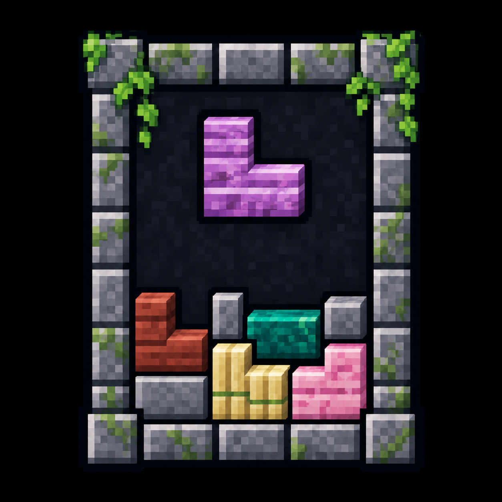

# Sky's Building Pieces — Biomes O' Plenty

Bring Biomes O' Plenty materials into your builds with the same range of pieces
as Sky's Building Pieces. This add-on supplies missing slabs, steps, corners,
stairs and stone or gem walls, using the textures of the original BOP blocks.

## Building with BOP materials

Build with all 16 plank woods, bamboo thatching, eight stone materials
and eight gem blocks. Redwood, ebony and eucalyptus are included. Where BOP
already has a suitable slab or stair, the add-on uses it rather than adding
another copy.

Craft pieces from matching blocks, slabs and steps, following the core mod's
patterns. Regular slabs also place vertically and drop regular slabs when
broken. Matching pieces can join into supported larger shapes.

Stone and gem walls have lower panels and raised posts, just like the core's
walls. Use BOP's own fences and gates for wooden builds; this add-on doesn't add
wooden walls or generate terrain.

See [crafting](docs/RECIPES.md) for the patterns and quantities.

## Flower Basket

The Flower Basket holds 18 slots of plants, saplings, leaves and other suitable
plant blocks. Right-click with it in either hand to open it. Carry it in your
main inventory and plant items you pick up go into the basket first, with
anything that doesn't fit handled normally.

Craft a basket from six wooden sticks. The [basket guide](docs/FLOWER-BASKET.md)
shows the recipe and explains storage and automatic collection. The basket
holds plant blocks, not ordinary seeds or unrelated items.

## Installation

Use the versions for **Minecraft 1.12.2**, with **Forge 14.23.5.2859** and
**Java 8**. You'll need:

- **Sky's Building Pieces 0.3.6.112021** and this add-on.
- **Biomes O' Plenty 7.0.1.2445**.

Put all three main jars in `mods` on both the client and server.
Downloads are on [CurseForge](https://www.curseforge.com/minecraft/mc-mods/skysbuildingpiecesbop).

For smoother BOP grass and soil, use the separate
[Terrain Smoother BOP add-on](https://github.com/MinecraftModDevelopmentMods/SkysTerrainSmoother-BiomesOPlenty-Addon)
with Sky's Terrain Smoother.

## Existing worlds

Before moving a world from 1.10 to 1.12, read
[existing worlds and modpack notes](docs/WORLD-UPGRADES.md). It covers recovery
for supported old building pieces, retired BOP rocks, decorations, Flower
Baskets and other items, including any replacement mods you'll need.

Mineralogy is optional. Retired rocks use its matching blocks when available;
otherwise the add-on supplies its own full-block replacements using Mineralogy
textures. Old crag rock becomes gabbro.

Back up your world and test a copy before upgrading.
See the [changelog](CHANGELOG.md) for release history.

## Licence

[LGPL-2.1-only](LICENSE), with third-party credits in [NOTICE](NOTICE).
Included Mineralogy assets retain their separate [LGPL-3.0 licence](MINERALOGY-LGPL-3.0.txt).
BOP textures are read from the installed mod, not bundled here.
